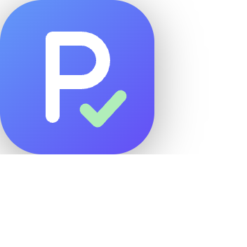
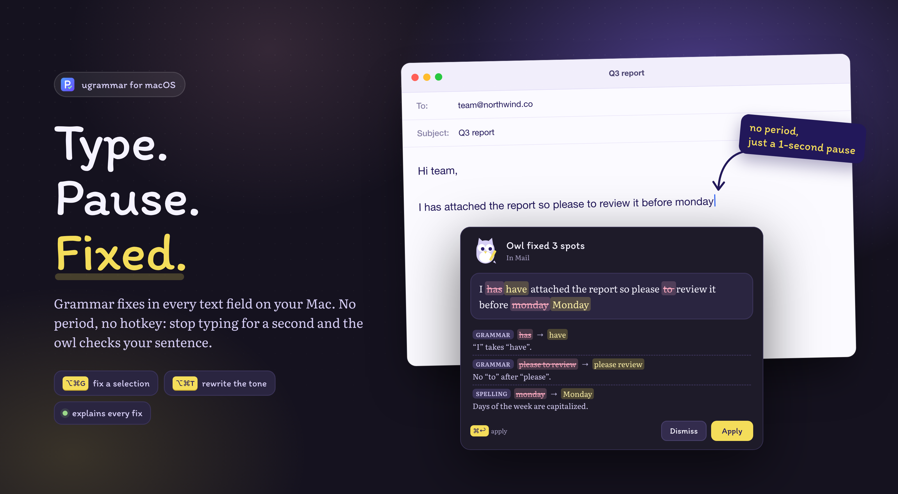

<div align="center">



# ugrammar

**Grammar fixes in every text field on your Mac.**<br>
Select text, press <kbd>⌥</kbd><kbd>⌘</kbd><kbd>G</kbd>, review the diff, apply. Or let it check while you type.

[](https://github.com/tinwritescode/ugrammar/releases/latest)
[](https://github.com/tinwritescode/ugrammar/releases/latest)
[](https://github.com/tinwritescode/ugrammar/releases)

[**Download for macOS**](https://github.com/tinwritescode/ugrammar/releases/latest/download/ugrammar-macos-arm64.zip) · [Features](#features) · [Install](#install) · [Build from source](#build-from-source)



</div>

## Features

- ✍️ **Works everywhere** — A menu-bar app that reads and writes text through Accessibility: Notes, Mail, Slack, Chrome, TextEdit and most other apps.
- ⚡ **Check as you type** — Each sentence is checked when you finish it, or after a one-second pause, period or not. Fixes you skip wait in the menu bar for later.
- 🔍 **Review every fix** — A word-level diff shows what changes. Keep or skip each fix, then apply with <kbd>⌘</kbd><kbd>↩</kbd>.
- 💡 **Learn from it** — Each fix is tagged grammar, spelling, punctuation, word or style, with a short reason in your language.
- 🎭 **Rewrite the tone** — <kbd>⌥</kbd><kbd>⌘</kbd><kbd>T</kbd> rewrites a selection as Natural, Formal, Friendly or Short, translates it, or tells you how it reads to the person receiving it.
- 🗂️ **Per-app style** — Friendly in Slack, formal in Mail: each app can have its own writing style.
- 📖 **Your words stay** — Names and jargon in your dictionary are never changed.
- 📊 **Weekly stats** — Words checked, fixes applied and your most common mistakes, stored only on this Mac.
- 🔄 **Auto-update** — New versions install themselves from GitHub Releases.

### Shortcuts

| Keys | Does |
|---|---|
| <kbd>⌥</kbd><kbd>⌘</kbd><kbd>G</kbd> | Check the selected text |
| <kbd>⌥</kbd><kbd>⌘</kbd><kbd>T</kbd> | Rewrite menu for the selected text |
| <kbd>⌘</kbd><kbd>↩</kbd> | Apply the fix in the popover |

The check hotkey can be changed in Settings.

## Install

1. Download [`ugrammar-macos-arm64.zip`](https://github.com/tinwritescode/ugrammar/releases/latest/download/ugrammar-macos-arm64.zip), unzip it and move **ugrammar.app** to Applications.
2. The app is not notarized: the first time, right-click it and choose **Open**.
3. Grant **Accessibility** when the permissions screen asks.
4. Pick an engine in Settings (see below).

> [!NOTE]
> Apple Silicon only. Updates keep the Accessibility grant, since every release is signed with the same certificate.

## Engines

- **Any OpenAI-compatible endpoint**: a local model (Ollama, LM Studio…) or a hosted one. Default `http://localhost:20128/v1`, model `xpiki/gpt-6.1-sol`.
- **Claude CLI**: each check runs `claude -p` with your logged-in Claude Code account, with no tools, no MCP and no saved session. The model defaults to `haiku`.

## Privacy

- Text goes only to the engine you pick: the selection you check or, with auto-check on, the sentence you are typing.
- Password and secure fields are skipped, as are excluded apps (1Password, Terminal, iTerm and more by default).
- The API key lives in the Keychain. Settings live in `~/Library/Application Support/ugrammar/settings.json`.
- Stats stay on this Mac, and the debug log records outcomes, never text.

## Build from source

Requires [Bun](https://bun.sh), Rust and Xcode command-line tools.

```bash
bun install
bun run dev        # builds the Swift helper and the web UI, then launches the app
bun run test       # Rust tests for core/ and src-tauri/
bun run typecheck  # checks the UI
```

Set `PROOFY_DEBUG=1` to log outcomes (never text) to `/tmp/proofy-debug.log`. Live Claude CLI test: `UGRAMMAR_LIVE_CLAUDE=1 cargo test --manifest-path core/Cargo.toml live_claude`. More in [`TESTING.md`](TESTING.md) and [`SPIKE.md`](SPIKE.md).

<details>
<summary><b>Project layout</b></summary>

- `core/`: the platform-free Rust crate: settings, engine client, diff, sentence and span logic, insights.
- `src-tauri/`: the app shell: windows and panels, the tray, the hotkey and check flow, auto-check, the helper process.
- `src/renderer/`: the web UI (popover, tray panel), bundled into `dist/` by `scripts/build.ts`.
- `helper/`: the Swift sidecar: hotkey, Accessibility read and write, clipboard, Keychain. It speaks JSON lines over stdio.

Claude CLI settings: `claudeModel` defaults to `haiku`; an empty `claudePath` finds `claude` on PATH, `~/.local/bin`, `~/.claude/local` or Homebrew.

</details>

<details>
<summary><b>Packaging and releases</b></summary>

```bash
bun run package   # -> release/ugrammar.zip (ugrammar.app, arm64, ad-hoc signed)
bun run release   # -> release/: signed app zips, ugrammar.app.tar.gz, its .sig, latest.json
```

`bun run release` signs with the self-signed certificate in `~/.ugrammar-signing` (`key.pem`, `cert.pem`) through `rcodesign` (`cargo install apple-codesign`), and signs the updater archive with `updater.key`. Accessibility grants follow the certificate, so they survive updates; an ad-hoc build loses them.

Upload everything in `release/` to the GitHub release tagged `v<version>`. Installed apps read `latest.json` from the latest release every six hours, install the update in place, and offer a restart from the menu bar panel.

⚠️ **Back up `~/.ugrammar-signing`.** Without those keys, installed apps reject new updates.

</details>

## Author

Made by Tín Nguyễn ([@tinwritescode](https://github.com/tinwritescode)). Issues and ideas: [github.com/tinwritescode/ugrammar/issues](https://github.com/tinwritescode/ugrammar/issues).
